# BALTACIOĞLU'S ERP Studio

Mobilya üretimi yapan bir atölye için kurumsal kaynak planlama (ERP) uygulaması. Bu sürüm bir **vitrin**: gerçek bir PostgreSQL veritabanı tarayıcının içinde çalışır, veriler ziyaretçinin tarayıcısından çıkmaz. Sunucu yalnızca isteğe bağlı asistan ucu içindir.

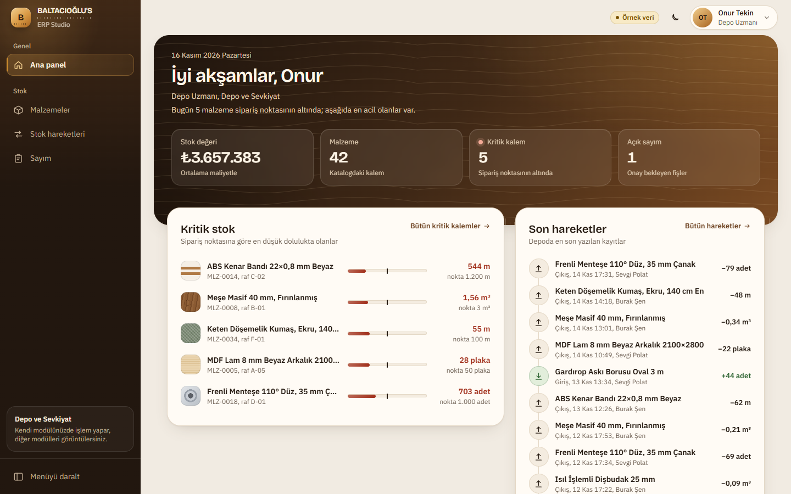

## Neler var

- **Giriş ve departmanlar:** 7 departman, 14 kurgusal çalışan. Her departman kendi modülünde işlem yapar, diğerlerini yalnızca görür. Operatör yürütür, uzman kayıt açar, müdür onaylar.
- **Ana panel:** stok değeri, kritik kalemler, açık sayımlar, son hareketler ve kategoriye göre stok değeri. Her özet ilgili süzülmüş listeye götürür.
- **Malzemeler:** 42 kalemlik katalog; Türkçe harfe duyarsız arama ("mese" → Meşe), kategori ve kritik süzgeçleri, sütun seçimi, CSV indirme, sipariş noktasını gösteren cetvel.
- **Stok hareketleri:** stok yalnızca hareketlerle değişir; her giriş, çıkış ve sayım farkı kayıtlıdır.
- **Sayım:** fiş açılır, raftaki miktar girilir, müdür onaylayınca farklar stok hareketine dönüşür.
- **Siparişler:** taslaktan sevke; satır ekleme, KDV hariç ve dahil toplam, onayda stok ayrılır ya da iş emri açılır, malzeme eksikse "Malzeme bekliyor". Durum çipleri, termin ve geciken işareti.
- **Müşteriler:** kurgusal müşteriler (gerçek il ve ilçeler), müşterinin siparişleri ve açık tutarı.
- **Ürünler:** mobilya kataloğundan ürünler; reçete, rota, mamul stoğu ve birim maliyet.
- **İş emirleri:** adım çizelgesi, ayrılan malzemeler, eksik listesi; planlama başlangıç gününü verir. Liste ya da kanban (Malzeme bekliyor, Planlanmadı, istasyon sütunları, Tamamlandı).
- **Haftalık plan:** istasyon × gün ızgarası, kapasite çubuğu; kart fareyle sürüklenir ya da klavyeyle taşınır, her taşıma önce onay ister ve işlem geçmişine yazılır. Taslak siparişte istasyon kapasitesine göre önerilen termin.
- **Satın alma:** kritik stok ve malzeme bekleyen iş emirlerinden tedarikçiye göre sipariş önerisi, tedarikçiler ve fiyat listeleri, satın alma siparişleri (50.000 TL'ye kadar onaysız, üstü Satın Alma müdürü, 250.000 TL üstü müdür ve Yönetim onayı; kademe gönderimde donar) ve depoda mal kabul (irsaliye, kısmi teslim, ortalama maliyet; malzeme bekleyen iş emirleri otomatik ayrılır).
- **İşlemler:** her değişikliğin kaydı; tür, departman, kişi, tarih ve metinle süzme, CSV.
- **Atölye:** istasyonun kuyruğu, tablette rahat büyük Başla ve Bitti düğmeleri; son adım bitince mamul stoğa girer, sipariş Hazır olur, depo sevk eder.
- **Kullanıcı yönetimi:** bilgi işlem ve yönetim kullanıcı ekler, düzenler, pasife alır, parola sıfırlar.
- **Ctrl+K paleti:** sayfaya git; sipariş, iş emri, müşteri, ürün ya da malzeme ara ve çekmecesini aç; "Yeni sipariş" (satışta); temayı değiştir.
- **Asistan:** her ekranda sağ altta sohbet balonu. Anahtar tanımlıysa Claude, stok, sipariş, iş emri ve satın alma için araçlarla tarayıcıdaki veriyi okur; sipariş onaylama ve satın alma taslağı gibi işlemleri önce bir onay kartında gösterir, "Onayla" denmeden hiçbir şey değişmez ve işlem giriş yapmış kişinin yetkisiyle çalışır. Anahtar yoksa ya da sınır dolduysa "Hızlı yardımcı" kritik stok, geciken siparişler, bugünün iş emirleri, kod durumu ve "nasıl yapılır" sorularını veritabanından cevaplar.
- Açık ve koyu tema, telefon görünümü, klavyeyle tam kullanım, "hareketi azalt" ayarına uyan animasyonlar.

| Giriş | Malzeme ayrıntısı | Telefon |
|---|---|---|
| 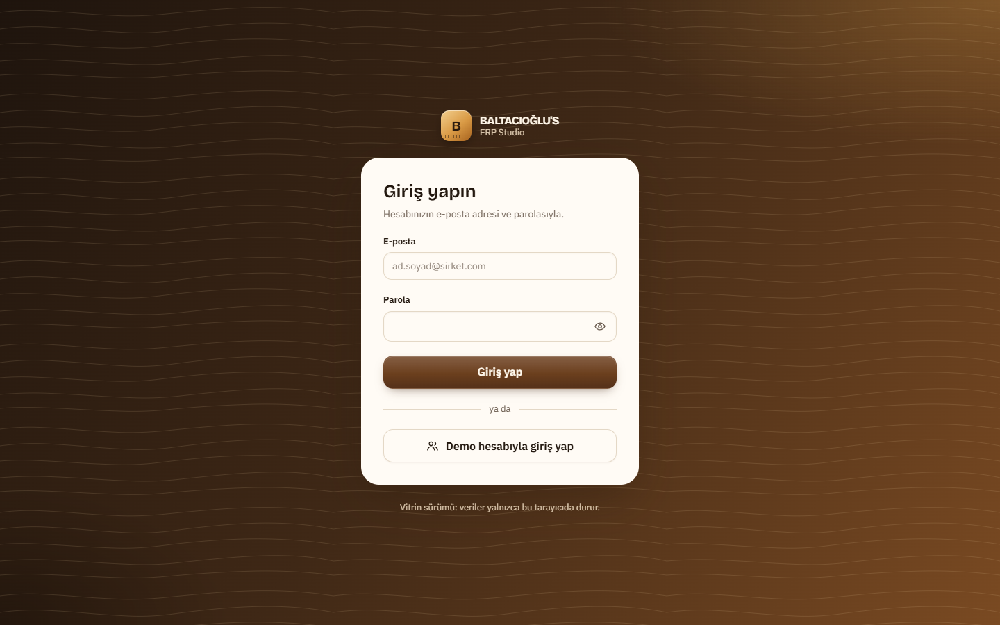 | 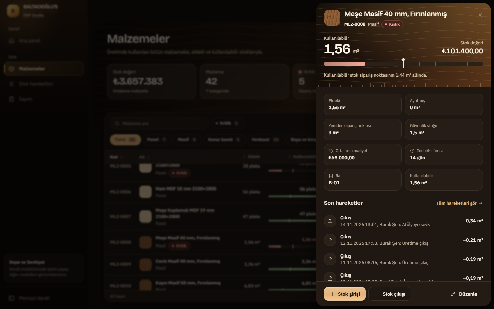 | 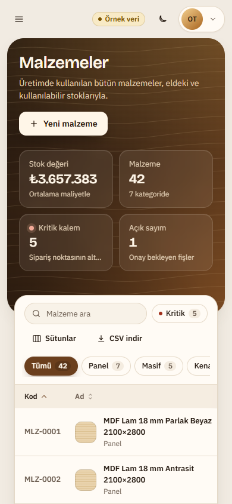 |

Satış ve üretim (Aşama 2A):

| Siparişler | Sipariş çekmecesi |
|---|---|
| 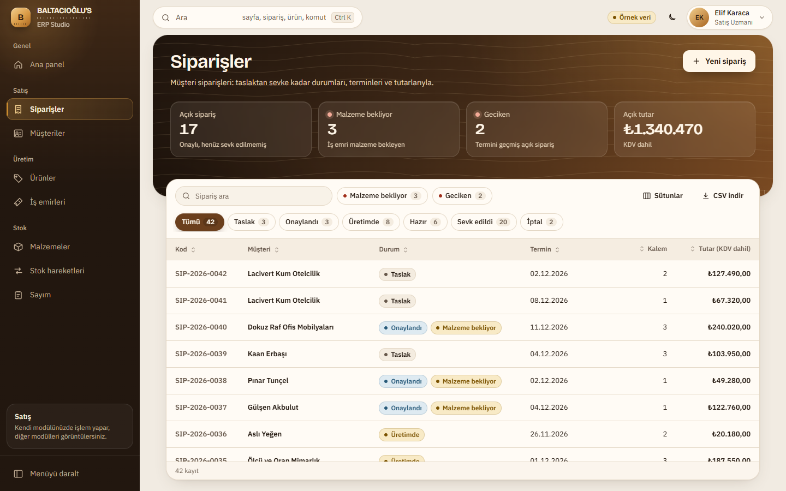 | 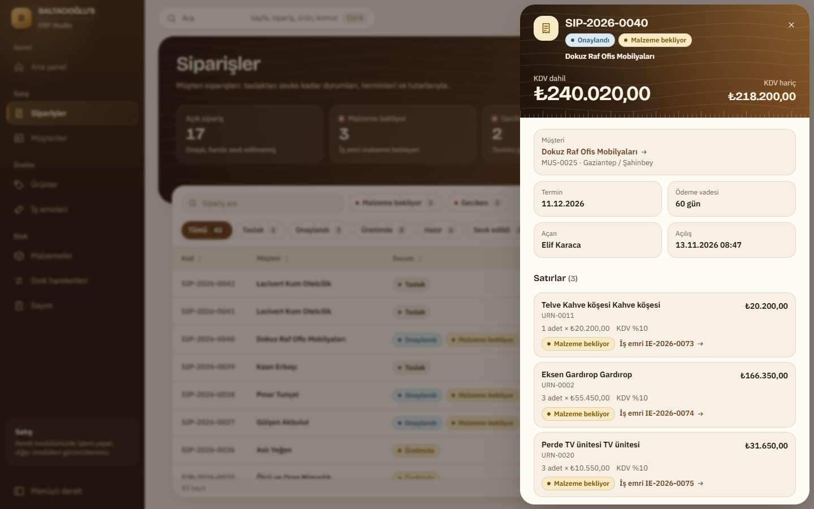 |

| İş emri çekmecesi | Atölye (tablet) | Siparişler (telefon) |
|---|---|---|
| 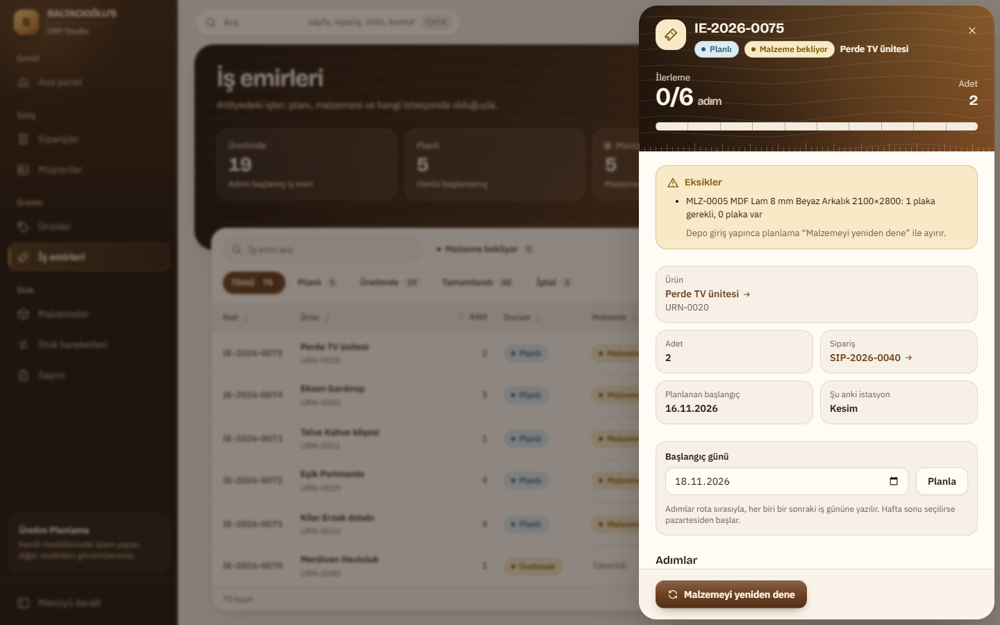 | 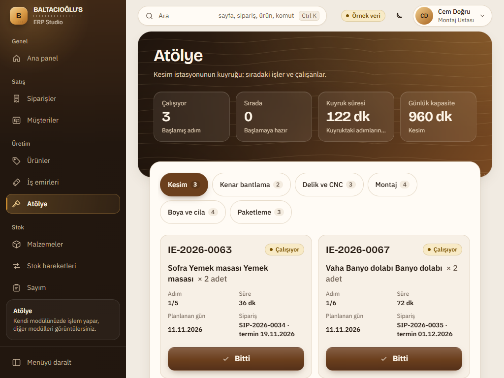 | 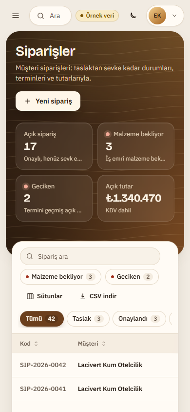 |

Diğer görüntüler `docs/screens/asama-2` klasöründe: müşteriler, ürün çekmecesi, iş emirleri ve masaüstü atölye.

Haftalık plan ve termin önerisi (Aşama 2B):

| Haftalık plan | Taşıma onayı |
|---|---|
| 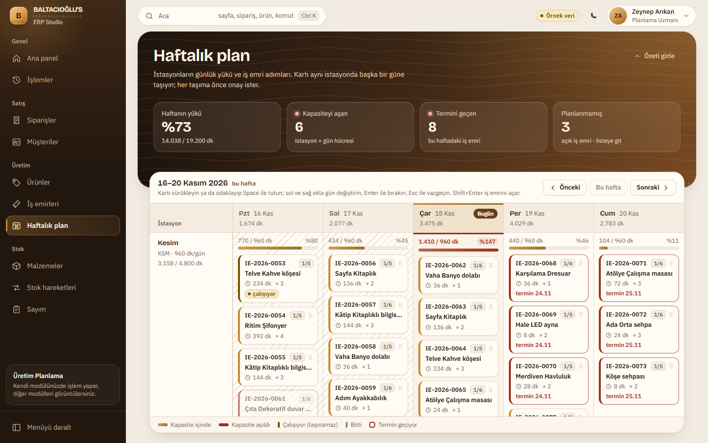 | 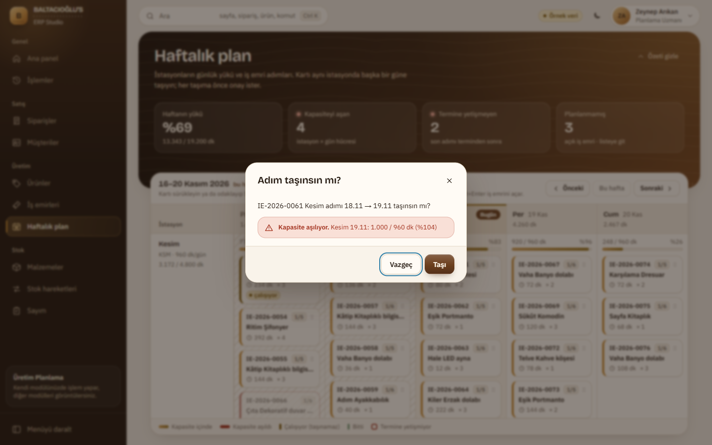 |

| İş emirleri kanbanı | Termin önerisi |
|---|---|
| 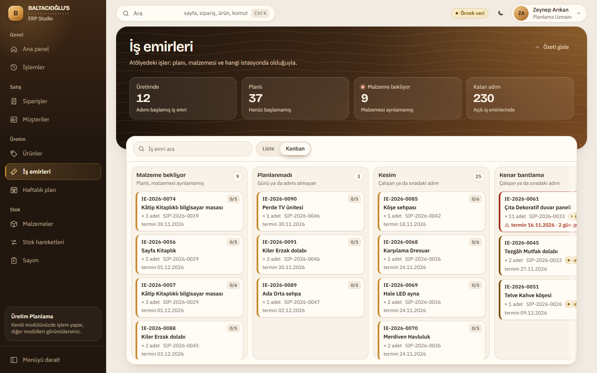 | 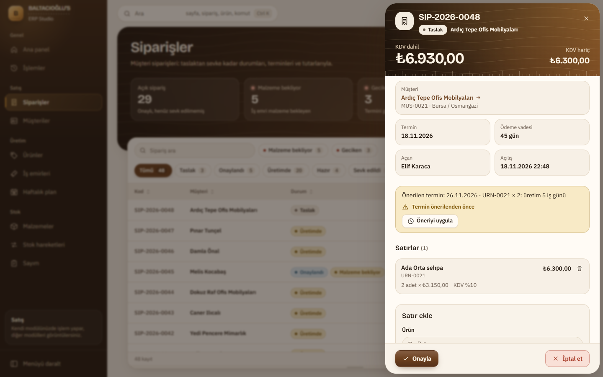 |

Tablet ve telefon görüntüleri ile özeti gizlenmiş liste `docs/screens/asama-2b` klasöründe.

## Çalıştırma

Node.js 24 ve npm gerekir.

```bash
npm install
npm run dev        # http://localhost:3001
```

Giriş ekranında **Demo hesabıyla giriş yap** düğmesi bütün çalışanları listeler. Demo parolası `Demo2026!`. Örneğin depo işlemleri için Onur Tekin (Depo Uzmanı), sayım onayı için Sevgi Polat (Depo ve Sevkiyat Müdürü), kullanıcı yönetimi için Ece Korkmaz (Sistem Uzmanı).

Veriler tarayıcıda kalır. Ayarlar → **Veriyi sıfırla** başlangıçtaki örnek veriye döner.

## Mimari

```
src/
  db/        Drizzle şeması, tarayıcıda PGlite (Web Worker + OPFS), göçler
  domain/    İş kuralları; React içermez. Stok yalnızca postMovement ile değişir, yetki burada da denetlenir
  seed/      Kurgusal örnek veri ve derleme sırasında üretilen anlık görüntü
  features/  Ekranlar (stok, satış, üretim ve atölye, kullanıcılar, ana panel, ayarlar)
  shell/     Açılış, giriş, oturum, menü, komut paleti
  ui/        Tasarım sistemi: renk belirteçleri, tablo, pencere, çekmece, cetvel göstergesi
```

- **Next.js 16** (App Router), **React 19**, **TypeScript** (strict), **Tailwind CSS 4**
- **PostgreSQL**: tarayıcıda [PGlite](https://pglite.dev) ile; sorgular **Drizzle ORM** üzerinden. İkinci aşamada aynı şema ve servisler sunucudaki PostgreSQL'e taşınacak.
- **TanStack Query** önbellek, **Zustand** oturum, **Radix** erişilebilir bileşenler, **cmdk** palet, **Motion** animasyon
- Para tam sayı kuruş, miktar tam sayı binde birim olarak saklanır; kayan noktalı tutar yoktur.

Depolama seçimi ve ölçümler için [docs/PROJECT_STATUS.md](docs/PROJECT_STATUS.md), örnek verinin kaynakları için [docs/DATA_SOURCES.md](docs/DATA_SOURCES.md).

## Yayın (Vercel)

Uygulama Vercel'e olduğu gibi yüklenir (`npm run build`, ek ayar dosyası gerekmez). Tek sunucu parçası `/api/asistan` ucudur; anahtar olmadan da uygulama eksiksiz çalışır.

| Ortam değişkeni | Anlamı |
|---|---|
| `ANTHROPIC_API_KEY` | İsteğe bağlı. Yoksa asistan "Hızlı yardımcı" modunda kalır. Yalnızca sunucuda okunur, tarayıcıya gitmez. |
| `ANTHROPIC_MODEL` | İsteğe bağlı. Varsayılan `claude-haiku-5-5`. |

`.env.example` boş değerlerle bir örnektir; gerçek anahtar `.env.local` dosyasına ya da Vercel panelindeki ortam değişkenlerine yazılır ve depoya girmez (`.gitignore` `.env*` dosyalarını dışarıda tutar).

- **Harcama sınırı:** Anthropic konsolunda hesap için aylık harcama sınırı koyun (önerilen: küçük bir üst sınır, örneğin 5 dolar). Uygulamadaki korumalar en iyi çabadır ve şunlardır: ziyaretçi (IP + çerez) başına saatte 20 yeni mesaj; ziyaretçi başına saatte 120 istek ve IP başına saatte 360 istek (araç turları dahil her istek bir hak yer, tur sayısı tarayıcıdan geldiği için ona güvenilmez); mesaj en çok 1000 karakter; araç sonucu en çok 8 blok ve toplam 24 bin karakter, ve her sonuç hemen önceki asistan turundaki bir araç çağrısına bağlı olmalıdır; cevap en çok 800 jeton; mesaj başına en çok 5 araç turu; Claude çağrısı 20 sn zaman aşımı ve 1 yeniden deneme. Sayaçlar sunucu örneğinin belleğindedir ve örnek yeniden başlayınca ya da başka bir örneğe düşünce sıfırlanır. IP, Vercel'in yazdığı `x-real-ip` başlığından alınır (başka bir ters vekil arkasında bu başlık sahtelenebilir).
- **Desteklenen modeller:** `ANTHROPIC_MODEL` olarak `claude-haiku-5-5` (varsayılan), `claude-haiku-4-5`, `claude-sonnet-5`, `claude-sonnet-4-6`, `claude-opus-5`, `claude-opus-4-8`, `claude-opus-4-7`, `claude-opus-4-6` kullanılabilir (uç kısa cevap için düşünmeyi kapatır ve çabayı `low` yapar; Haiku 4.5'e bu ayarlar gönderilmez). `claude-opus-5-5`, `claude-sonnet-5-5`, Fable ve Mythos modellerinde düşünme kapatılamadığı için uç bunları desteklemez ve hızlı yardımcıya düşer.
- **Gizlilik:** sohbet sunucuda saklanmaz; Claude'a yalnızca soru, araç sonuçları ve sabit sistem istemi gider.
- **Veritabanı dosyaları:** PGlite'ın `.wasm` dosyaları ve PostgreSQL dosya paketi içerik özetli adla `immutable` önbellekle gelir. Dosya paketi (~6 MB) normalde sıkıştırılmayan bir türde geldiği için `next.config.ts` içindeki `headers()` ile sıkıştırılabilir türe çevrilir (~1,9 MB iner). Yayın sonrası `node scripts/measure-boot.mjs` ile (`MEASURE_URL` ayarlanarak) gerçek adreste ölçülmelidir.

## Testler

```bash
npm test           # birim testleri (Vitest, gerçek PGlite veritabanıyla)
npm run test:e2e   # tarayıcı testleri (Playwright, başsız Chrome)
npm run verify     # tür denetimi, lint, birim testleri ve üretim derlemesi
```

721 birim testi ve 153 tarayıcı testi var. Tarayıcı testleri siparişten sevke beş departmanlı akışı, satın almada kritik stoktan öneri, onay, mal kabul ve üretime hazır iş emrine uzanan akışı, haftalık planda sürükle-bırak ve klavyeyle taşımayı, kanbanı, yetkileri, Türkçe aramayı, çift tıklamayı, iki sekmeyi, kapalı tarayıcı deposunu, klavye odağını ve telefon genişliğini kapsar.

## Durum

Plan 1 (temel, stok ve kullanıcılar), Plan 2A (satış ve üretim: siparişten sevke), Plan 2B (haftalık üretim planı, termin önerisi, kanban) ve Plan 3A (satın alma: öneri, onay, mal kabul) tamam; sırada Plan 3B (kur, bildirimler, eşik düzenleme), ardından raporlar ve yapay zekâ destekli yardımcı var.

Bu bir vitrin sürümüdür: kişi ve firma adları kurgusaldır, fiyatların bir kısmı tahmindir.
