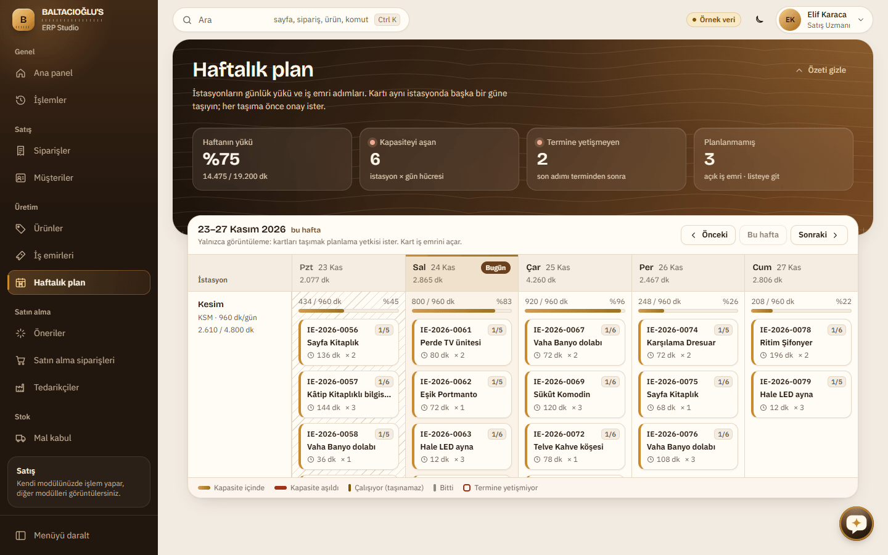

# BALTACIOĞLU'S ERP Studio

Mobilya atölyesi için kurumsal kaynak planlama: siparişten sevke, stoktan satın almaya tek uygulama.

Bir mobilya atölyesinin ERP'sini gösteren bir vitrin. Gerçek bir PostgreSQL veritabanı doğrudan tarayıcının içinde çalışır; veriler ziyaretçinin tarayıcısından hiç çıkmaz.

## Öne çıkanlar

- **Siparişten sevke:** satış, üretim, depo ve sevkiyat tek akışta; sipariş onayında stok ayrılır ya da iş emri açılır.
- **Haftalık üretim planı:** istasyon ve gün ızgarası, kapasite çubukları, sürükle-bırak ya da klavyeyle taşıma ve her taşımada onay.
- **Satın alma:** kritik stoktan tedarikçiye göre sipariş önerisi, tutara göre onay zinciri ve depoda irsaliyeli mal kabul.
- **Rehberli asistan:** başlık kutucukları, kart cevapları, yazım hatası toleransı; değişiklik yapmadan önce her zaman onay ister.
- **Ctrl+K paleti:** sayfaya git, kayıt ara, çekmecesini aç.
- **Açık ve koyu tema**, telefon ve tablet görünümü, klavyeyle tam kullanım.
- **Her değişikliğin kaydı:** kim, ne zaman, ne yaptı.

## Kullanılan teknolojiler

- **Next.js 16** ve **React 19**: uygulama iskeleti
- **TypeScript** ve **Tailwind CSS 4**: tür güvenliği ve tasarım sistemi
- **PGlite**: tarayıcının içinde çalışan PostgreSQL
- **Drizzle ORM**: şema ve sorgular
- **TanStack Query**: veri önbelleği
- **Radix UI**: erişilebilir bileşenler
- **cmdk**: Ctrl+K komut paleti
- **dnd-kit**: haftalık planda sürükle-bırak
- **Motion**: animasyonlar

Firma ve kişi adları kurgusaldır, fiyatlar herkese açık Türkçe kaynaklardan alınmıştır; ayrıntı için [docs/DATA_SOURCES.md](docs/DATA_SOURCES.md).
